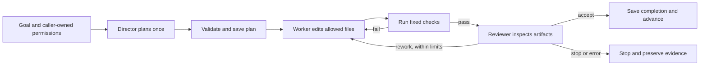

# Choose the AI for each role

Register connections once, then select their names in each job. A `director` plans, a `worker` edits files, and a `reviewer` accepts the result or requests rework. They can use different providers, models, or the same registered connection. DispatchDock controls the queue, checks, limits and checkpoints.



Use Node 24; the CLI is dependency-free. These are source-level CLI/JS features; opening a PR does not upgrade an installed desktop app or global skills.

1. Copy [agents.example.json](../skills/codex-dispatch/examples/agents.example.json). Set real URLs, model IDs, and environment-variable **names**. Supply credentials in the launching process environment, never in JSON.
2. Run `node /absolute/DispatchDock/skills/codex-dispatch/dispatch.mjs agents import /private/agents.json`. Existing configuration is backed up; duplicate names require `--replace`. `agents list` lists profiles; `agents check builder` checks local launchability and credential presence only (`networkChecked:false`).
3. Copy [workflow.example.json](../skills/codex-dispatch/examples/workflow.example.json) into an isolated target Git worktree. Set `director`, `worker`, `reviewer`, `goal`, permitted `files`, optional `contextFiles`, fixed `checks`, and limits. Checks use absolute executables or `@node` plus literal argument arrays. The planner cannot add commands or broaden file permissions.
4. From the **target repository root**, run:

```sh
node /absolute/DispatchDock/skills/codex-dispatch/dispatch.mjs workflow ./workflow.json
node /absolute/DispatchDock/skills/codex-dispatch/dispatch.mjs status parser-maintenance
node /absolute/DispatchDock/skills/codex-dispatch/dispatch.mjs workflow ./workflow.json --resume
node /absolute/DispatchDock/skills/codex-dispatch/dispatch.mjs stop RUN_RECORD_NAME
```

Keep the foreground CLI process alive. The planner phase precedes queue registration; interrupt it from its launching terminal. Once queued, use the printed record name to stop its process tree. Resume reuses the adopted plan, completed tasks and budget, and refuses changed goals, permissions or execution/review profiles. New work needs a new queue name. This entry point does not install a persistent service.

| Entry | Behavior |
|---|---|
| `task "description" --agent builder` | A caller directly delegates one task; read-only by default |
| `plan workflow.json --out plan.json` | Invoke the director and save a bounded plan for inspection |
| `run plan.json` | Execute prepared cards with checks and review; do not call the director |
| `workflow workflow.json` | Plan once, then execute, check and review, with bounded rework |

`--host` is a source label; it does not invoke that AI. `supervisor` remains a legacy alias of `reviewer`. Existing `codex-task.mjs`, Codex and DeepSeek defaults remain compatible.

Connections support `adapter:"chat-completions"` with `model` and `api:{baseUrl,apiKeyEnv,parameters?}`, native `adapter:"codex"` aliases, or `adapter:"bridge"` with an absolute `path`, literal `args`, and optional `credentialEnv`. API endpoints need compatible Chat Completions and tool calling. Provider-specific SDKs/CLIs require a bridge; a website-only chat cannot be connected just by naming it. See the fail-closed [bridge template](../skills/codex-dispatch/examples/bridge-template.mjs). Other registered credentials are filtered out before launching a role.

The ESM [index.mjs](../skills/codex-dispatch/index.mjs) exports `workflow({request,root,env?,resume?})`, `run({plan,root,env?,resume?})`, `plan({request,root,env?})` and `invoke({agent,operation,prompt,root,outputSchema?,policy?,env?})`. Windows imports should use a `file:///D:/...` module URL. Bridges receive `operation`, `outputSchema`, and settings on stdin and emit unified JSONL events; their final `say.text` is the result. Review returns `{"decision":"accept|rework|stop","feedback":"evidence"}`.

Request/token limits cover worker attempts; planning and review have separate per-call limits. Built-in API workers track usage; external CLI costs cannot be measured universally, so unknown worker usage retains its reservation. These are not a global currency cap. API file tools enforce an allowlist; external bridges must implement their own sandbox/policy contract. Post-run Git checks cannot replace OS isolation or detect every transient/ignored change. Fixed checks execute project code.

Evidence and checkpoints live in `.codex-runs/`. Stopping preserves uncommitted work; the queue does not commit, push, publish, or roll back. Independent detached tasks do not gain automatic cascade-stop semantics. The queue is sequential, not a DAG scheduler.

The previous DeepSeek write-capable execution and Codex review were verified against real endpoints. Generic roles are covered through an isolated compatible server, including planning, tool writes, checks, review-driven rework and resume, plus a native Codex alias fixture. This does not certify every provider/account/model or add a universal connection editor to the desktop UI. See the [detailed Chinese guide](ai-workflow.md), [queue details](night-queue.en.md), and [bridge contract](generic-workers.md).
