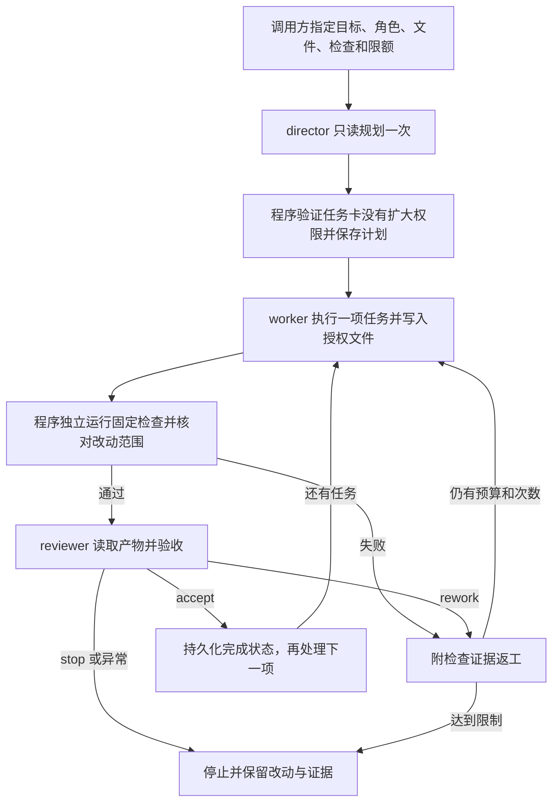

# 自选 AI 的规划、执行与验收

配置一次 AI 连接，以后每份任务只选择名字。`director` 拆任务，`worker` 改文件，`reviewer` 验收；三者可以是同一供应商的不同模型，也可以来自不同供应商。调用这些命令的聊天 AI 或人是调用方，不需要绑定某个产品。



程序控制顺序、检查、权限清单、重试与持久化。AI 的“完成了”不能替代检查与验收。当前是顺序队列，不提供 DAG 或多个 worker 并发写同一工作树。

## 首次配置

需要 Node 24。CLI 和 JS API 是本分支源码能力；已安装桌面软件与全局技能不会随 PR 自动升级，连接页仍保留原来的安装入口。直接运行脚本不需要 `npm install`。

1. 复制 [agents.example.json](../skills/codex-dispatch/examples/agents.example.json)，把地址、模型 ID 和环境变量名改成自己实际使用的配置。JSON 只存变量名，密钥放到启动进程的环境中。
2. 在自己的终端把凭据导入环境，然后执行：

```powershell
$dispatch = 'D:/tools/DispatchDock/skills/codex-dispatch/dispatch.mjs'
node $dispatch agents import D:/private/agents.json
node $dispatch agents list
node $dispatch agents check builder
```

把示例路径换成自己的源码或技能目录。导入会保留无关配置、备份原文件；同名配置默认拒绝覆盖，确需替换时加 `--replace`。`CODEX_DISPATCH_HOME` 可以指定独立配置目录；默认位置见 [文件协议](protocol.md)。`agents check` 只检查本机可启动性与环境变量是否存在，输出 `networkChecked:false`，不代表接口、模型或余额已经验证。

支持三种连接：

| adapter | 配置与要求 |
|---|---|
| `chat-completions` | `model`、`api.baseUrl`、`api.apiKeyEnv`；接口需要支持 Chat Completions 与文件工具调用。`api.parameters` 可补供应商参数，不强塞 DS 专用参数 |
| `codex` | 本机已登录的 Codex CLI；可另取 `lead` / `judge` 等名字，选择不同 `model`，可设绝对 `path` |
| `bridge` | 绝对 `path`、字面 `args`、可选 `credentialEnv`；接入任意 CLI/SDK，由桥接程序实现统一 stdin/stdout 契约 |

没有 API、CLI 或桥接能力的网页聊天不能直接接入。Claude/Gemini 等供应商原生 SDK 需要自己实现桥接，不能仅填一个模型名。桥接起点见 [bridge-template.mjs](../skills/codex-dispatch/examples/bridge-template.mjs)；模板未实现时明确失败，避免误报成功。已声明的其他角色凭据会从当前角色进程环境中过滤；需要的非标准凭据变量用 `credentialEnv` 声明。

原有 `codex` / `deepseek` 名称、`codex-task.mjs` 入口和配置继续可用。`adapter:"codex"` 的例子：

```json
{"agents":{"lead":{"adapter":"codex","model":"your-codex-model"}}}
```

## 每次怎么调用

复制 [workflow.example.json](../skills/codex-dispatch/examples/workflow.example.json) 到目标项目，改目标、文件、检查和队列名。关键字段：

```json
{
  "v": 1,
  "name": "parser-maintenance",
  "goal": "修复空输入解析并保留现有行为",
  "director": "lead",
  "worker": "builder",
  "reviewer": "judge",
  "files": ["src/parser.mjs"],
  "contextFiles": ["src/parser.mjs", "tests/parser.test.mjs"],
  "checks": [{"name":"parser-tests","executable":"@node","args":["--test","tests/parser.test.mjs"],"timeoutMs":60000}]
}
```

`files` 是允许修改的明确文件，`contextFiles` 是执行端可读的上下文；检查由调用方写好，模型不能发明新检查命令。`@node` 使用当前 Node，其他程序必须是绝对路径。检查会执行项目代码，应在自己准备的隔离 Git 工作树运行。完整示例还包含一晚的限额。

在**目标仓库根目录**执行（`$dispatch` 仍指向 DispatchDock 的绝对入口）：

```powershell
node $dispatch workflow ./workflow.json
node $dispatch status parser-maintenance
node $dispatch workflow ./workflow.json --resume
node $dispatch stop <运行时输出的记录名>
```

`workflow` 前台持有队列，需保持宿主进程存活。其他终端可查状态或停止；规划期间还没有队列记录，可在启动终端中断。进入队列后用输出的记录名停止整棵进程树。恢复会核对进程锁、目标、范围和执行/验收配置，复用已采纳的计划与预算，不重复规划或重跑已验收的任务。改变目标应使用新的队列名。关掉终端不等于可靠的后台托管；本入口没有安装常驻服务。

| 命令 | 用途 |
|---|---|
| `task "任务" --agent builder` | 当前对话里的上级直接派一项工作，自己收汇报；默认只读，可按已有策略参数授权写入 |
| `plan workflow.json --out plan.json` | 只调用 director 生成受约束的计划，供人检查；不覆盖已有输出 |
| `run plan.json` | 执行已准备的任务卡队列、检查、验收和返工，不再次调用 director |
| `workflow workflow.json` | 一次调用完成规划、执行与验收循环 |

`--host` 仅标记派发来源，不会启动那个 AI。实际自动调用的上级由 `director` / `reviewer` 选择。旧计划中的 `supervisor` 等价于 `reviewer`；旧 `worker:{model:...}` 默认 DS、旧 supervisor 默认 Codex。

## 给其他 AI 或程序直接调用

告诉上级：“阅读这份流程，在目标仓库用绝对入口运行 `workflow`，按指定的三个配置名派发，停止后读证据汇报。”不用为每个上级再编写一套供应商调用逻辑。

Node ESM 也可直接复用：

```js
import { workflow, run, invoke } from '/absolute/DispatchDock/skills/codex-dispatch/index.mjs';
// Windows 用 file:///D:/tools/DispatchDock/... 形式的模块 URL。
await workflow({ request, root: '/absolute/target-repo' });
await run({ plan, root: '/absolute/target-repo', resume: true });
const result = await invoke({ agent: 'lead', operation: 'plan', prompt: '...',
  root: '/absolute/target-repo', outputSchema: yourSchema });
```

调用结果的语义仍由调用方校验。桥接收到 `operation`（`plan/execute/review`）、`outputSchema` 与 `settings`；规划/验收只读，最后一个 `say.text` 必须是符合操作约定的结果。验收 JSON 为 `{"decision":"accept|rework|stop","feedback":"证据与意见"}`。完整契约见 [通用执行端](generic-workers.md)。

## 限额、证据与实际边界

- `limits.maxMinutes/maxAttempts/maxReviews` 控制队列时长、单任务尝试次数与验收次数；`maxRequests/maxTokens` 约束执行端预算。内置 API 执行端记录真实请求/token；外部 CLI 不能统一统计内部费用，未知用量保留最坏预留。规划与验收各有自己的调用限制，不能把 worker 预算当整个工作流的统一费用上限。
- 内置 API 用受限文件工具落实清单；外部 CLI/bridge 的 `sandbox/policy` 需要其自身落实，程序还会事后检查 Git 可观察的越界改动。这不是为任意程序提供 OS 沙箱，也不能检测一切瞬时或忽略文件的改动。
- `.codex-runs/` 保存规划、状态、每次尝试的文件基线、检查、汇报、调用元数据和预算。停止会保留未提交改动，不自动回滚，也不提交、推送或发布。
- 任务父子关联用于观察；队列进程树可以停止，独立托管或脱离进程树的任务不会自动级联停止。不要给 worker 再次派发权限。

## 已验证范围

已有 DS 真实接口可写执行和 Codex 验收的证据；通用角色的回归采用隔离本地兼容接口，实际走规划 → 文件写入 → 固定检查 → 验收返工 → 再次写入 → 接受 → 恢复。它验证协议与控制流程，不代表每个供应商、账号和模型均已通过真实调用。桌面 UI 的任意角色配置编辑器不在本次范围内。
